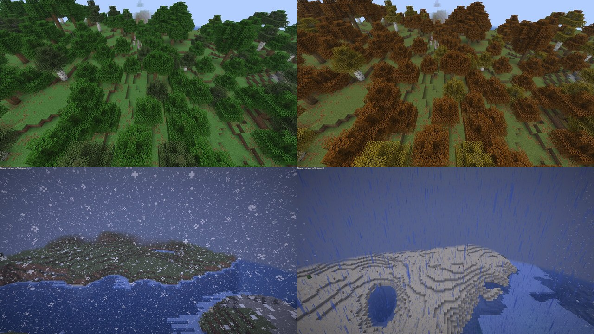

# Almanac

Almanac is a seasons and weather mod for Minecraft 26.3 (Fabric). The year has twelve sub-seasons, storms form and move
across the land, and the snow, ice, grass and leaves follow the seasons. **It's needed on the server and on every
player's game:** a server running Almanac refuses players who don't have it.

*A forest in summer and fall, snow over the plains in winter, and rain in a winter desert.*

## What it does

- **Seasons:** early, mid and late spring, summer, fall and winter. Each season lasts 24 in-game days by default, and you can change that.
- **Regional weather:** storms are born, grow, drift with the wind and die away, so it rains or snows in one valley and not the next.
  - A storm lasts from a few hours to two days of game time. Summer brings small, quick storms that often thunder; winter brings large, slow snowstorms.
  - Each place is under rain or snow a quarter of the time (plain Minecraft rains about a sixth of the time; a server setting changes it), and thunder and lightning only come under a thunderstorm.
  - Everything the weather touches goes by the storm where it is: farmland, fire, fishing, cauldrons, lightning, mobs, bees and sleeping through a thunderstorm.
  - You can turn it off for one weather everywhere, as in plain Minecraft.
- **Weather by climate:** every biome is HOT (deserts, badlands), COLD (the snowy biomes) or TEMPERATE (everything else). Winter moves each one a step colder and summer a step warmer.
  - Deserts get rain in winter.
  - Plains and forests get snow in winter.
  - Snowy places get rain in summer.
  - Jungles stay temperate and never get snow: they get rain in winter.
  - Mid summer is dry in temperate land.
- **Snow that comes and goes:**
  - Snow builds up a layer at a time while it snows, on scattered columns as plain Minecraft lays it, up to three layers by default. When it warms up it melts again, the top layer first. You can set how long a layer takes to build and to melt.
  - The snow lies where the storms went, thinning out at a storm's edge.
  - Chunks you haven't visited in a while catch up the moment they load, with the snow that has fallen or melted while you were away.
  - Ponds and lakes freeze from the shore inward in winter and thaw from the middle in spring. Open oceans stay open, so you can still cross them by boat.
  - Snow you place never melts, and neither does snow on your builds or high up on mountains, or ice under something you've built.
- **Colours:** grass and leaves change through the year, a little every day. Each kind of tree has its own fall colours: oak goes orange-brown, birch yellow and dark oak red-brown.
- **Far terrain:** with Distant Horizons or Voxy and LiteLights 1.1.0, the far land follows the seasons too. LiteLights paints the snow on it from a map of the biomes around you that the server sends.
- **Sandstorm-friendly:** in places where nothing can fall, a storm darkens the sky as in plain Minecraft, so mods like LiteLights can turn it into a sandstorm.

## Install

1. Use Minecraft 26.3 with Fabric Loader 0.19.5 or newer, Fabric API 0.165.2 or newer, and Java 25.
2. Drop the jar from the [latest release](../../releases/latest) into the server's `mods` folder **and** into every player's `mods` folder. In singleplayer, put it in your game's `mods` folder; friends joining over LAN need it too.
3. Mod Menu is optional. It adds the settings screen to the mod list; without it, bind the "Almanac" key under Options, Controls, Key Binds.

New worlds start in early spring. `/season` shows where you are in the year.

### Upgrading from 0.1.3.2

Replace the jar on the server and on every player's game. Players with an older Almanac, or none, are refused with a message saying which Almanac to install.

An existing world keeps its season and day, its snow, its frozen ponds and its settings. Regional weather starts the first time the world opens on 1.0, from exactly the snow the world had. Your settings file keeps every value and gains the new settings at their defaults; `thawDays`, `vanillaClientCopies` and `refreshChunksPerTick` no longer do anything and are dropped. Rain shares you left at their old defaults move to 100, so every storm reaches wherever the season lets anything fall.

## Commands and settings

- `/season` shows the current sub-season and how many days are left. Anyone can use it.
- `/season set`, `/season pause`, `/season resume` and `/season length <days>` are for operators.
- `/weather rain` and `/weather thunder` put a storm over you, and `/weather clear` clears the sky for 2,500 blocks around you. A setting (or `/almanac weather everywhere`) makes them act on the whole world, as in plain Minecraft. Turning off the `advance_weather` game rule stands every storm still.
- `/almanac weather` shows the weather where you stand; `/almanac weather storms` the storms near you, how big they are and which way they're heading; `/almanac weather forecast` when it next rains or snows where you stand.
- `/almanac config` lists and changes every server setting, and `/almanac config reload` reads the settings file again after you've edited it by hand. `/almanac snow` shows the snow in each climate.
- Everything is on one settings screen too (through Mod Menu, or the keybind), in pages for the seasons, the climate, snow and ice, the weather and your own game. On a server the pages show the server's settings; operators can change them there, and the server saves them and sends them to everyone. Everyone else can see them but not change them. In singleplayer they are your own.

Server settings are saved in `config/almanac-server.json`. If you edit it by hand and make a mistake, Almanac moves it aside as `almanac-server.json.broken` instead of overwriting it, and says so in the log.

## Compatibility

- Fabric Seasons, Serene Seasons and Immersive Snow Reloaded do the same jobs as Almanac, so the game won't start with any of them installed alongside it.
- Other mods that ask whether it's raining in the world as a whole hear "no" while regional weather runs, since it rains in some places and not others. Mods can ask Almanac about a place instead (see below).
- Almanac doesn't draw storm clouds itself: the sky's clouds stay as in plain Minecraft, while the rain, the darkening and the fog follow the storm.
- **Snow! Real Magic:** at its default settings there's no seasonal snow. Set `debug.forceVanillaIceSnowLogic: true` in `config/snowrealmagic-common.yaml` to get it back.
- Swamp grass keeps the swamp's own colours all year.
- Overworld only.

If something breaks, please open an issue with your log and mod list and I'll take a look.

## For mod authors

Almanac has an API for mods that draw weather, place snow or colour terrain. It covers the season, the climate at a spot, what falls there, the storms (where each one is at any moment, so they can be drawn), the snow and ice by place, and far-terrain snow. It's in the `com.thenathe.almanac.api` package and documented in [docs/INTEGRATION.md](docs/INTEGRATION.md), which lists what each version added and removed and shows how to check which version is installed.

## Credits

Almanac is written from scratch, but the ideas behind it came from other mods:

- **[Fabric Seasons](https://github.com/lucaargolo/fabric-seasons)** by lucaargolo: changing biomes in memory, and keeping track of the snow the weather places.
- **[Serene Seasons](https://github.com/Glitchfiend/SereneSeasons)** by Glitchfiend: sub-seasons and rain timing.
- **[Immersive Snow Reloaded](https://github.com/CerealCamera/Immersive-Snow-Reloaded)** by Straywave and contributors: bringing snow up to date when chunks load.
- **Create: Sky**, **Climate: Clouds, Storms, Technology**, **ProtoManly's Weather** and **Simple Clouds**: regional weather that moves across the land, and clouds grouped where the weather is.

No code was copied from any of them. The full list, with what each idea was, is in [CREDITS.md](CREDITS.md).

## License

MIT, see [LICENSE](LICENSE).
